# Architecture and invariants

```mermaid
flowchart LR
  A[User intent and selected sources] --> B[Discovery and provenance]
  B --> C[Extract and inspect source pages]
  C --> D[Ordered IR with stable IDs]
  D --> E[Agent supplies both complete editions]
  E --> F[Semantic review and mechanical audit]
  F --> G[One-source HTML and alignment]
  G --> H[Measured browser pagination]
  H --> I[Actual page inspection]
  I --> J[Fresh review records and release]
```

The portable SKILL is the decision layer. References explain conditional methods. Scripts provide deterministic transformations; platform sidecars only affect discovery/loading. One corrected IR feeds every language, edition and alignment artifact. No platform owns the content contract.

Source SHA-256 prevents silent input substitution. Translation packets bind an extraction-only source snapshot; review records bind the complete project/content snapshot. Visual records and render reports also bind output hashes. Editing the source, scope, meaning, style or outputs invalidates the relevant record rather than silently inheriting approval.

Release gates detect missing translations/alignment, unresolved extraction issues, unreviewed figure labels, stale review snapshots and failed/stale layout reports. They cannot determine whether a reviewer read a page or whether a translation is correct. Honest descriptions and actual source comparison remain essential.

Work projects can resume: keep manifests, corrected IR, terminology, source hashes and reports; regenerate only changed outputs. Source archives and external webpages never gain execution authority. Publication excludes private sources, intermediate credentials and machine-specific paths.
